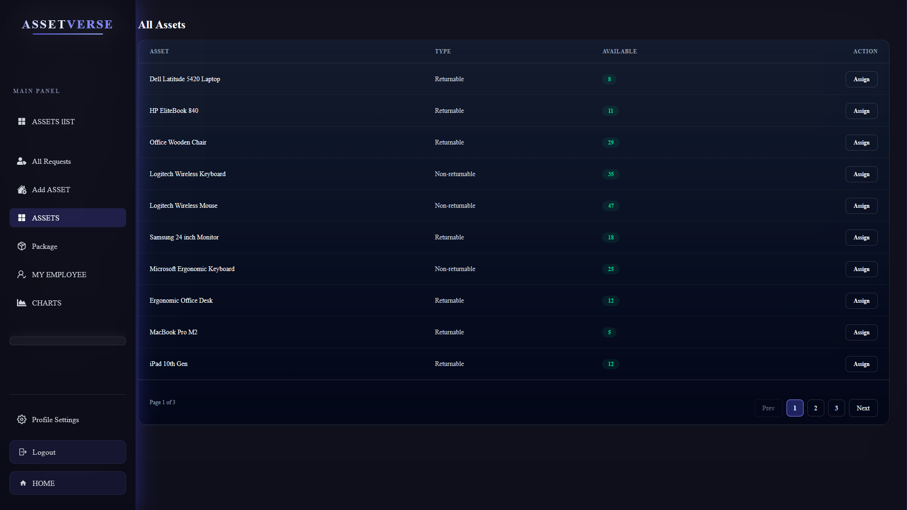

# AssetVerse 🏢📦

A modern **B2B HR & Asset Management Web Application** designed to help organizations efficiently manage company assets and employee assignments.

AssetVerse streamlines asset tracking, improves accountability, and reduces administrative overhead for HR teams.

---
## 🖥️ Dashboard Preview



## 🔗 Live Demo
👉 https://asset-verse-n57c.vercel.app/

---

## 🎯 Project Overview
[](https://gitdiagram.com/itssopno/asset-verse?utm_source=readme&utm_medium=picture)
**AssetVerse** allows companies to:
- Track physical assets (laptops, routers, projectors, etc.)
- Assign assets to employees
- Monitor asset availability and return status
- Manage employees affiliated with one or multiple companies

This project was built as a **B2B SaaS-style application** inspired by platforms like **BambooHR**, **Zoho People**, and **Freshservice**.

---

## 🚀 Key Features

### 👨‍💼 HR / Admin Features
- Company registration with default subscription (5 employees)
- Add, update, and manage assets
- Track asset availability in real-time
- Approve or reject employee asset requests
- View assigned and returned assets

### 👩‍💻 Employee Features
- Employee registration and authentication
- Request assets from company inventory
- View assigned assets
- Support for working with multiple companies

### 📦 Asset Management
- Asset lifecycle: **Inventory → Assignment → Return**
- Support for **returnable & non-returnable** assets
- Real-time availability tracking

---

## 🛠️ Tech Stack

### Frontend
- React
- React Router
- Tailwind CSS
- DaisyUI
- Framer Motion
- GSAP
- Lenis (Smooth Scroll)

### Authentication & Security
- Firebase Authentication
- JWT (JSON Web Token)

---

## 🎨 UI / UX Highlights
- Modern dark-themed SaaS dashboard
- Glassmorphism & gradient design
- Fully responsive layout
- Smooth animations & transitions
- Clean sidebar navigation

---

## 🔐 Authentication Flow
- User authentication handled via Firebase
- JWT issued after login for secure API access
- Role-based access (HR / Employee)

---

## 🔧 Installation / Run Locally

Follow these steps to run **AssetVerse** on your local machine:

1. **Clone the repository**  
```bash
git clone https://github.com/itsSopno/assetverse.git
cd assetverse


---
npm install i
npm install react-router
npm install -D tailwindcss postcss autoprefixer
npx tailwindcss init -p
npm install daisyui
npm install framer-motion
npm install gsap
npm install firebase
npm i lenis

.end file :
REACT_APP_API_KEY=your_api_key
REACT_APP_AUTH_DOMAIN=your_project.firebaseapp.com
REACT_APP_PROJECT_ID=your_project_id
REACT_APP_STORAGE_BUCKET=your_project.appspot.com
REACT_APP_MESSAGING_SENDER_ID=your_sender_id
REACT_APP_APP_ID=your_app_id

npm start
 


